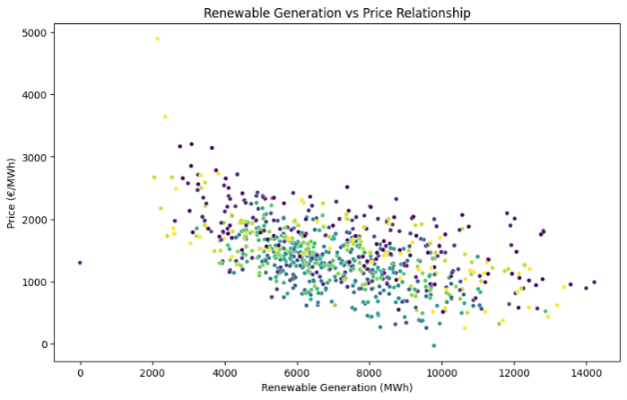
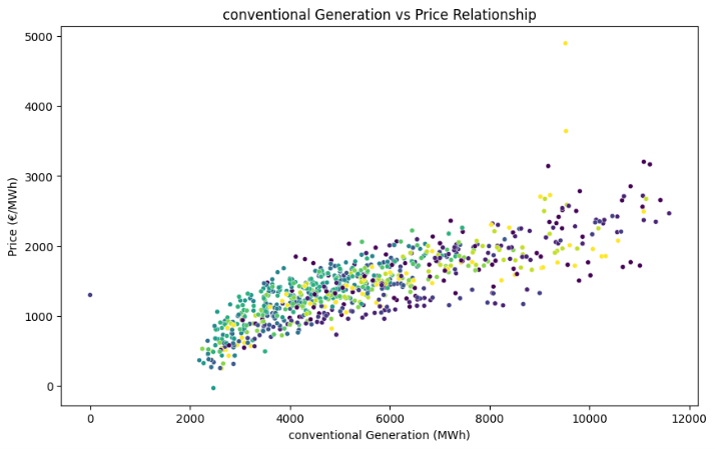
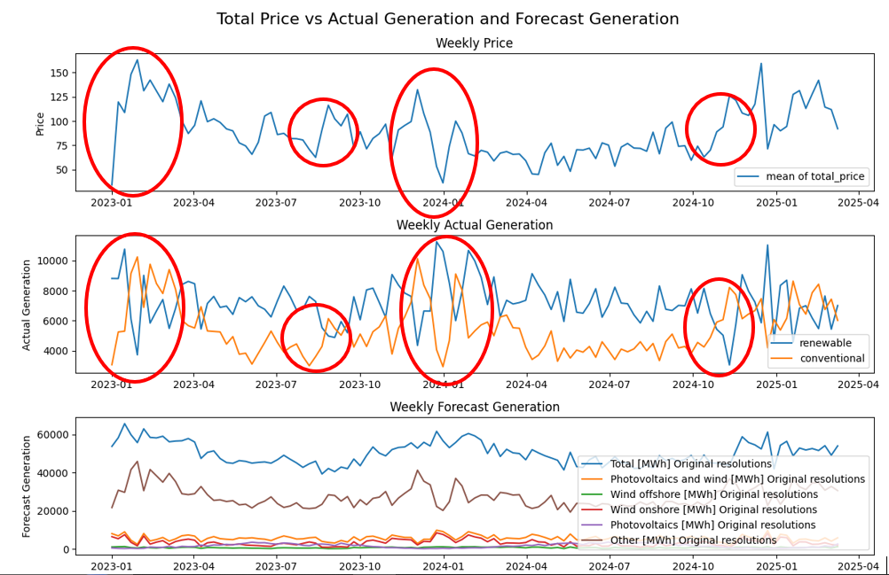
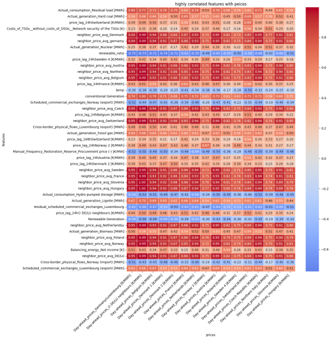
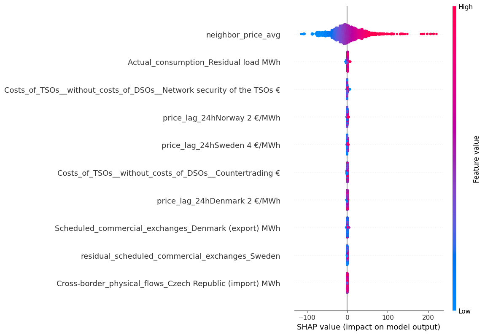
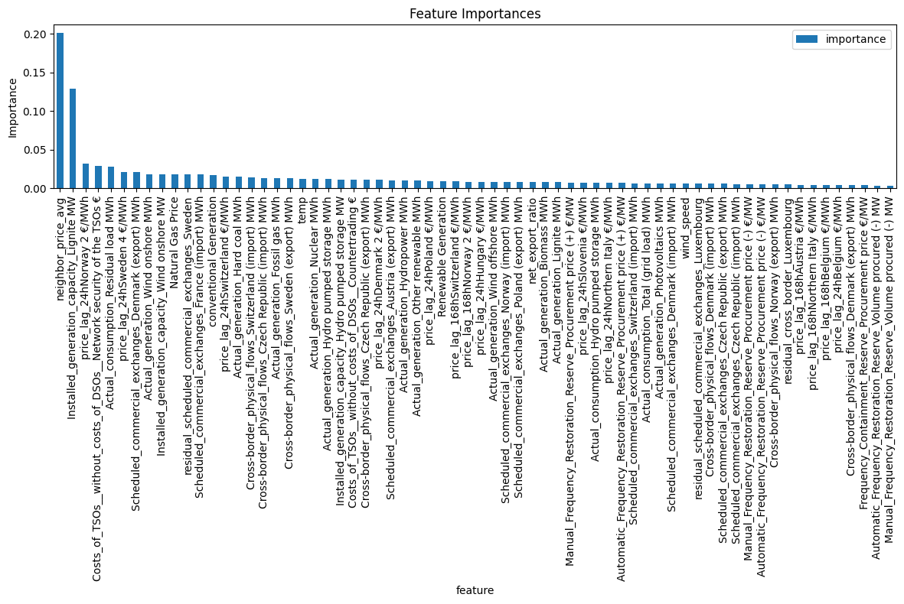

<div align="center">

# ⚡ Electricity Power Cast

### Accurate Electricity Price Forecasting for the German & European Market

*A machine learning pipeline: EDA → feature engineering → imputation → stacked ensemble forecasting*








</div>

---

## 📌 Overview

Electricity prices are shaped by many forces at once: supply, demand, the mix of renewable and conventional generation, cross-border trade, and grid-balancing costs. This project uses high-resolution data from **[SMARD](https://www.smard.de/)** (Germany's electricity market platform) to understand these forces and to **forecast day-ahead electricity prices for 16 European bidding zones**.

The project covers the full data science workflow:

1. **Exploratory Data Analysis** of prices, generation, consumption, cross-border flows, and balancing costs
2. **Feature engineering** with new features, external weather and gas-price data, and smart missing-value handling
3. **Model-based imputation** for key features with large gaps
4. **Stacked ensemble forecasting** (Random Forest + XGBoost, combined with Linear / Ridge stackers)
5. **Interpretability** with SHAP, LIME, and feature importance

> 📄 A full written report with all figures and analysis is available in this repository: `ElectricityPowerReport.pdf`.

---

## 🎯 Key Results

| Model | MAE (€/MWh) | RMSE (€/MWh) | R² |
|---|:---:|:---:|:---:|
| Random Forest | 7.45 | 13.26 | 0.927 |
| XGBoost | 8.38 | 14.14 | 0.916 |
| **Stacked Ensemble (Linear Regression)** | **7.00** | **12.51** | **0.936** |
| **Stacked Ensemble (Ridge)** | **7.00** | **12.51** | **0.936** |

**Directional accuracy of the stacked ensemble** (does the price go up or down?):

| Rise | Fall | Stable | Overall |
|:---:|:---:|:---:|:---:|
| ~91.6% | ~92.4–92.6% | ~12% | ~91.0–91.3% |

- The model detects **extreme price movements** (>15% change) with 100% accuracy on the test data.
- Directional accuracy ranges from **86.96% (Sweden)** to **96.67% (DE/LU)** across the 15 evaluated zones.
- The ensemble beats each single model, and the choice of stacker (Linear vs. Ridge) makes almost no difference.

---

## 📊 Dataset

| Property | Details |
|---|---|
| **Source** | SMARD (Bundesnetzagentur) |
| **Period** | January 2023 – March 2025 |
| **Files** | 16 CSV files (yearly, monthly, hourly, and quarter-hourly data) |
| **Themes** | Day-ahead prices, generation (actual & forecast), consumption, installed capacity, cross-border physical flows, scheduled commercial exchanges, balancing reserves, TSO costs |
| **Merged data** | 76,216 rows × 130 columns (quarter-hourly) |
| **Final modeling data** | 19,052 rows × 212 columns (hourly) |

**External data added:**
- 🌤️ **Weather** (temperature, wind speed, solar radiation) via the [Meteostat](https://meteostat.net/) API
- ⛽ **Henry Hub natural gas spot price** from the U.S. Energy Information Administration (EIA)

---

## 🔍 Exploratory Data Analysis — Highlights

- **Volatility & seasonality:** Prices range from €0 to €400/MWh and are highest in winter.
- **Generation mix matters:** Conventional sources (lignite, hard coal, fossil gas) correlate positively with price. For example, in DE/LU the correlations are 0.67, 0.56, and 0.65. Renewables correlate negatively.
- **Price coupling:** Prices across most countries move together. Austria, Germany, Belgium, the Czech Republic, the Netherlands, and France show correlations above 0.92.
- **Consumption:** Clear daily and weekly cycles, with higher demand in winter. Residual load is much more volatile than total grid load.
- **Cross-border flows:** Scheduled commercial exchanges and physical flows track each other closely.
- **Grid costs:** TSO network-security costs show the highest correlation with prices (0.58).
- **Forecast quality:** The official load forecast is accurate (MAPE 3.71%), but residual-load forecasts are much weaker (MAPE 35.43%).

---

## 🛠️ Feature Engineering

**Data cleaning**
- Merged all datasets on `End date`
- Removed duplicate timestamps (4 dates), keeping the most recent record
- Resampled quarter-hourly data to hourly means; back-filled monthly and yearly data

**New features**
- **Forecast error** (actual vs. forecast) for generation and consumption
- **Aggregated generation:** renewable, conventional, and total
- **Net flow** for commercial exchanges and cross-border flows, per country
- **Temporal:** hour, day of week, month
- **Lagged prices:** 24-hour and 168-hour lags, plus 7-day rolling standard deviation
- **Ratios:** `renewable_ratio`, `net_export_ratio`
- **Regional price averages** from neighboring countries (`neighbor_price_avg_*`)

**Feature selection**
- Kept features with |correlation| ≥ 0.5 to prices
- Removed 19 highly inter-correlated features (|corr| > 0.9)

**Missing-value strategy** (127 of 212 columns had gaps)

| Missing share | Columns | Approach |
|---|:---:|---|
| < 5% | 87 | Filled with the median |
| 5% – 80% | 23 | Trained XGBoost imputers; **5** reached good accuracy and were filled, the rest were kept as-is |
| > 80% | 17 | Dropped |

**Imputation model quality (R²)**

| Feature | R² |
|---|:---:|
| Natural gas price | 0.512 |
| FCR procurement price | 0.850 |
| aFRR procurement price (+) | 0.963 |
| mFRR procurement price (+) | 0.834 |
| mFRR procurement price (−) | 0.933 |

---

## 🤖 Modeling Approach

```
        ┌──────────────────┐     ┌──────────────────┐
        │  Random Forest   │     │     XGBoost      │      ← base models
        └────────┬─────────┘     └────────┬─────────┘        (handle missing values)
                 └───────────┬────────────┘
                             ▼
              ┌──────────────────────────────┐
              │ Stacker: Linear Regression / │              ← meta-models
              │            Ridge             │
              └──────────────┬───────────────┘
                             ▼
                  Day-ahead price forecast
                    (per bidding zone)
```

- Features were standardized; **targets were kept in their original scale (€/MWh)**.
- Base models were chosen because they can handle missing values.
- Evaluated with MAE, RMSE, R², directional accuracy (rise / fall / stable), and extreme-movement detection.

### 🔎 What drives the predictions? (SHAP & LIME)

- **Neighbor price average** → strongest positive impact
- **Conventional generation** (especially lignite) and **residual load** → strong positive impact
- **TSO countertrading costs** → negative impact
- **Lagged prices of neighbors** (e.g., Norway, Sweden) → smaller but still significant

---

## ⚠️ Limitations

- **Stable periods are hard to predict** (~12% accuracy). The model is better at detecting trends than flat periods.
- **Sudden sharp spikes and drops** are captured in direction but not always in exact value.
- **Cross-border flows are treated as fixed inputs**, not as responding to prices.
- **The 100% extreme-movement accuracy** should be read with care, since extreme events are rare in the test data.
- **Short history:** only about two years of data, so rare events and long-term trends are limited.

---

## 🚀 Future Work

- Use real **weather forecasts** (not only historical weather) for wind and solar
- Model **cross-border flows dynamically** as price-responsive
- Move to **finer time resolution** for intra-hour use cases
- Add **adaptive / online learning** so the model keeps up with changing grid conditions
- Add **explainability modules** to support regulatory needs (e.g., EU AI Act)

**Potential use cases:** trading support, industrial load-shifting, and grid reserve planning.

---

## 📁 Repository Structure

```
Electricity-Power-Cast/
│
├── EDA1.ipynb                          # Exploratory data analysis (part 1)
├── EDA2.ipynb                          # Exploratory data analysis (part 2)
├── EDA_3.ipynb                         # Exploratory data analysis (part 3)
├── Feature_Engineering.ipynb           # Merging, new features, external data, missing values
├── In_depth_analysis.ipynb             # Feature correlations & model-based imputation
├── Price_Prediction_Models.ipynb       # Random Forest & XGBoost base models
├── model_aggregated.ipynb              # Stacked ensemble (Linear / Ridge) & evaluation
│
├── dates.csv                           # Date index data
├── normalized_features.csv             # Standardized feature set
├── transformed_imputed_5_features.csv  # Dataset with the 5 imputed features
│
└── ElectricityPowerReport.pdf          # Full project report
```

---

## ▶️ Getting Started

**1. Clone the repository**
```bash
git clone https://github.com/malihealavi/Electricity-Power-Cast.git
cd Electricity-Power-Cast
```

**2. Install dependencies**
```bash
pip install numpy pandas matplotlib seaborn scikit-learn xgboost shap lime meteostat jupyter
```

**3. Run the notebooks in this order**

| Step | Notebook | Purpose |
|:---:|---|---|
| 1 | `EDA1.ipynb`, `EDA2.ipynb`, `EDA_3.ipynb` | Understand the data |
| 2 | `Feature_Engineering.ipynb` | Build the modeling dataset |
| 3 | `In_depth_analysis.ipynb` | Impute key features |
| 4 | `Price_Prediction_Models.ipynb` | Train and evaluate base models |
| 5 | `model_aggregated.ipynb` | Train and evaluate the stacked ensemble |

> The raw SMARD data can be downloaded from [smard.de](https://www.smard.de/en/downloadcenter/download-market-data).

---

## 🧰 Tech Stack

`Python` · `Pandas` · `NumPy` · `Scikit-learn` · `XGBoost` · `SHAP` · `LIME` · `Matplotlib` · `Seaborn` · `Meteostat` · `Jupyter`

---

## 👩‍💻 Author

**Malihe Alavi**
Data Scientist — Medical Imaging & Applied Machine Learning

🔗 GitHub: [@malihealavi](https://github.com/malihealavi)

---

<div align="center">

⭐ If you find this project useful, consider giving it a star!

</div>